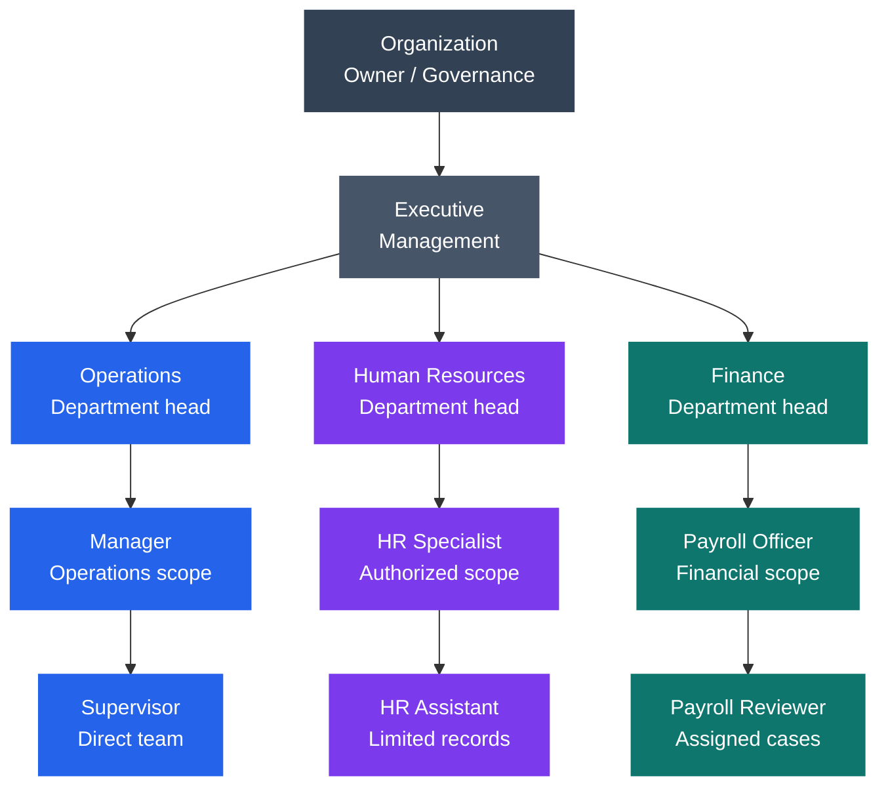
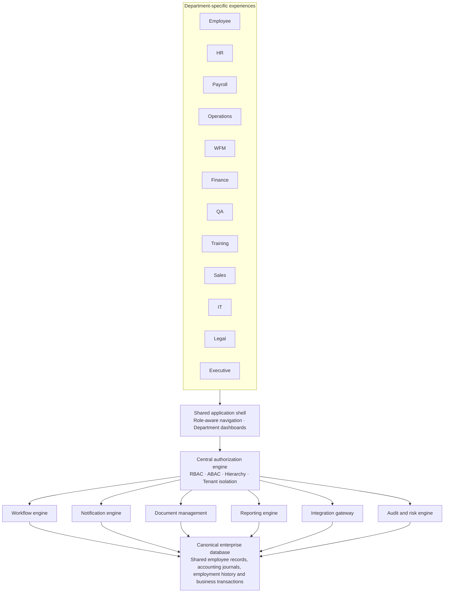

# NForce — Complete Enterprise Functionality Roadmap

NForce should become a unified enterprise workforce management platform covering the entire employee lifecycle, departmental operations, HR, payroll, finance, sales, administration and executive management.

I reviewed the latest [NForce repository](https://github.com/nasrinaiv0/NForce), application routes, database migrations, shared business-rule modules, enterprise architecture and the P1.6 statutory coverage plan.

## 1. Current project status

### Enterprise release readiness — HOLD

| Verification | Status |
|---|---|
| Core unit tests | 159/159 |
| Application unit tests | 184/184 |
| Previously reported npm vulnerabilities | 0 — Reduced from 3 |
| Existing role experiences | 9 |
| Latest audited commit | `08840a4` |
| Database and RLS tests | Passed |
| Web build | Passed |
| Vercel deployment | Passed |
| Latest browser and native acceptance | Running |
| Production approval | Not authorized |

**Good news:** All three previously reported npm vulnerability findings are now cleared by the latest registry audit.

[Latest CI evidence](https://github.com/nasrinaiv0/NForce/actions/runs/45346766391) · [Current pull request](https://github.com/nasrinaiv0/NForce/pull/26)

The following audit uses four classifications:

- 🟢 Implemented in the repository.
- 🟡 Partially implemented or requires integration and acceptance.
- 🔴 Missing dedicated functionality or not evidenced as implemented.
- 🔵 Recommended enterprise expansion.

## 2. Complete departmental coverage

NForce should support configurable departments rather than hardcoding every company into the same organizational structure.

### Proposed department inventory

| Total | Partial | Missing dedicated module |
|---:|---:|---:|
| 23 | 12 | 11 |

Inventory filters in the original interactive roadmap: **All · Partial · Missing**. All entries are included below.

| Department | Features | Priority · Status |
|---|---|---|
| Employee Self-Service | Personal dashboard, attendance, schedules, leave, payslips, requests, personal documents and employment history. | P0 · Partial coverage |
| Human Resources | Employee lifecycle, digital 201 files, policies, contracts, benefits and employee relations. | P1 · Partial coverage |
| Payroll | Statutory compensation, payroll closing, disbursement, remittances and employee disputes. | P0 · Partial coverage |
| Workforce Management | Scheduling, forecasting, staffing, capacity, adherence and real-time workforce monitoring. | P1 · Partial coverage |
| Operations | Team performance, productivity, service levels, escalations and operational scorecards. | P1 · Partial coverage |
| Finance & Accounting | General ledger integration, budgets, accounts payable/receivable and reconciliation. | P1 · Partial coverage |
| Executive Management | Company-wide KPIs, strategic goals, forecasts and authorized aggregate reporting. | P1 · Partial coverage |
| IT & Security | Access administration, device inventory, service desk, security events and access reviews. | P0 · Partial coverage |
| Sales | CRM, pipeline, quotas, commissions, forecasts and sales performance. | P2 · Partial coverage |
| Customer Service | Tickets, customer cases, SLAs, escalations and customer satisfaction. | P2 · Dedicated module not evidenced |
| Quality Assurance | Evaluations, scorecards, calibration, disputes and coaching integration. | P2 · Dedicated module not evidenced |
| Learning & Development | Training, learning paths, assessments, certifications and skills tracking. | P2 · Dedicated module not evidenced |
| Recruitment | Applicant tracking, interviews, hiring approvals and onboarding. | P2 · Dedicated module not evidenced |
| Legal & Compliance | Compliance calendar, contract reviews, investigations and regulatory evidence. | P1 · Dedicated module not evidenced |
| Internal Audit & Risk | Audit plans, risk register, control testing and remediation. | P1 · Dedicated module not evidenced |
| Procurement | Purchase requests, purchase orders, supplier management and approvals. | P3 · Dedicated module not evidenced |
| Facilities & Administration | Office locations, room reservations, maintenance and workplace requests. | P3 · Dedicated module not evidenced |
| Inventory & Logistics | Assets, stock movements, equipment issuance and inventory reconciliation. | P3 · Dedicated module not evidenced |
| Marketing | Campaigns, budgets, lead attribution and marketing performance. | P3 · Dedicated module not evidenced |
| Project Management | Projects, milestones, dependencies, resource allocation and delivery reporting. | P2 · Partial coverage |
| Health, Safety & Environment | Safety incidents, hazard reporting, occupational health and corrective actions. | P2 · Dedicated module not evidenced |
| Business Intelligence | Custom reports, dashboards, cross-department analytics and permission-aware metrics. | P2 · Partial coverage |
| Platform Administration | Tenant governance, subscriptions, entitlements, system health and incident response. | P0 · Partial coverage |

This is a proposed 23-department coverage model, not a claim that every organization needs 23 separate departments. Small companies should be able to combine these functions.

## 3. Remaining functionality per department

### Employee self-service

| Functionality | Status |
|---|---|
| Personal dashboard and profile | 🟢 |
| Attendance and break tracking | 🟢 |
| Personal schedules | 🟢 |
| Overtime and leave requests | 🟢 |
| Payslip history and PDF export | 🟢 |
| Payroll disputes | 🟢 |
| Secure native document sharing | 🟡 |
| Personal document repository | 🔴 |
| Certificate of Employment requests | 🔴 |
| Employee help desk | 🔴 |
| Company announcements | 🔴 |
| Employee surveys and feedback | 🔴 |
| Offline attendance synchronization | 🟡 |

### Human Resources

| Functionality | Status |
|---|---|
| Employee directory | 🟢 |
| Department and hierarchy assignment | 🟢 |
| Employment history | 🟢 |
| Employee onboarding and offboarding | 🟡 |
| Digital 201 files | 🟡 |
| Employment contract management | 🔴 |
| Probation monitoring | 🔴 |
| Promotion and salary adjustment workflows | 🟡 |
| Disciplinary action management | 🔴 |
| Employee grievance management | 🔴 |
| Performance improvement plans | 🔴 |
| Benefits enrollment | 🔴 |
| Employee engagement surveys | 🔴 |
| Succession planning | 🔴 |
| Employee clearance | 🔴 |
| Exit interviews | 🔴 |

### Payroll

| Functionality | Status |
|---|---|
| Canonical monetary ledger | 🟢 |
| Gross-to-net computation | 🟡 |
| Daily, weekly, semi-monthly and monthly payroll | 🟡 |
| Overtime, holiday and night differential | 🟡 |
| SSS, PhilHealth and Pag-IBIG | 🟡 |
| Tax withholding and annualization | 🟡 |
| 13th-month pay | 🟡 |
| Maternity differential and reimbursement | 🟡 |
| Separation and retirement pay | 🟡 |
| Payroll corrections and reversals | 🟡 |
| Independent payroll approvals | 🟢 |
| Detailed employee payslips | 🟢 |
| Government loan deductions | 🟡 |
| Complete government filing adapters | 🔴 |
| Bank salary disbursement | 🔴 |
| Payment confirmation and reconciliation | 🔴 |
| Multi-country payroll | 🔵 |

The existing [P1.6 statutory coverage plan](https://github.com/nasrinaiv0/NForce/blob/staging/p1-5-canonical-consolidation/docs/release/p1-6-statutory-coverage-plan.md) addresses much of the remaining Philippine payroll scope. It should be completed before attempting international payroll.

### Workforce Management (WFM)

| Functionality | Status |
|---|---|
| Shift scheduling | 🟢 |
| Team roster | 🟢 |
| Weekly and monthly calendar | 🟢 |
| Attendance analytics | 🟢 |
| Timesheet review | 🟡 |
| Attendance exceptions | 🟡 |
| Shift swapping | 🔴 |
| Employee availability management | 🔴 |
| Real-time adherence (RTA) | 🔴 |
| Schedule adherence | 🔴 |
| Staffing and capacity planning | 🔴 |
| Intraday management | 🔴 |
| Shrinkage forecasting | 🔴 |
| Automated schedule optimization | 🔴 |
| Historical workforce forecasting | 🔴 |
| Headcount planning | 🔴 |

### Operations

| Functionality | Status |
|---|---|
| Team management | 🟢 |
| Hierarchical approvals | 🟢 |
| Work Center and task assignments | 🟢 |
| Operational reporting | 🟡 |
| Custom operational KPIs | 🟡 |
| Productivity tracking | 🔴 |
| Daily, weekly and monthly scorecards | 🔴 |
| Coaching management | 🔴 |
| Escalation management | 🔴 |
| Corrective action plans | 🔴 |
| Shift handover | 🔴 |
| Client and campaign management | 🔴 |
| Service-level monitoring | 🔴 |
| Business review reporting | 🔴 |

### Finance and Accounting

| Functionality | Status |
|---|---|
| Canonical payroll accounting journals | 🟢 |
| Payroll liability reconciliation | 🟡 |
| General ledger integration | 🔴 |
| Cost centers | 🔴 |
| Departmental budgets | 🔴 |
| Budget versus actual reporting | 🔴 |
| Accounts payable | 🔴 |
| Accounts receivable | 🔴 |
| Expense reimbursement | 🔴 |
| Cash advance management | 🔴 |
| Financial approval workflows | 🔴 |
| Bank reconciliation | 🔴 |
| Profit and loss reporting | 🔴 |
| Balance sheet | 🔴 |
| Financial period closing | 🔴 |

For finance, NForce should integrate with existing accounting software where practical instead of immediately developing a second full accounting system.

### Quality Assurance (QA)

**Dedicated module not evidenced**

Required functionality:

- Custom evaluation forms and weighted scorecards.
- Interaction and transaction sampling.
- Critical-error and compliance evaluation.
- Quality calibration sessions.
- QA disputes and independent appeal decisions.
- Agent, supervisor and department quality dashboards.
- Root-cause analysis and recurring error trends.
- Coaching referrals and corrective action tracking.

### Learning and Development (L&D)

**Dedicated module not evidenced**

Required functionality includes a course library, training schedules, employee learning paths, quizzes, examinations, certification expiration tracking, skills matrices, nesting performance, knowledge-base management and training effectiveness reporting.

Training completion should feed employee eligibility and workforce planning without granting trainers unnecessary access to confidential HR or payroll records.

### Recruitment and Talent Acquisition

**Dedicated module not evidenced**

#### Proposed recruitment workflow

1. Headcount and vacancy request
2. Budget and hiring approval
3. Job posting and applicant tracking
4. Screening and assessments
5. Interview and hiring decision
6. Offer letter and contract
7. Pre-employment requirements
8. Employee onboarding

Approved candidates should become employee records without manually duplicating their information.

### Sales and Business Development

| Functionality | Status |
|---|---|
| CRM foundation | 🟢 |
| Sales pipeline | 🟢 |
| Deal movement | 🟢 |
| Customer and contact lifecycle | 🟡 |
| Sales targets and quotas | 🔴 |
| Sales commissions | 🔴 |
| Commission integration with payroll | 🔴 |
| Sales forecasting | 🔴 |
| Territory management | 🔴 |
| Quotations and proposals | 🔴 |
| Sales incentives and recognition | 🔴 |
| Customer retention analytics | 🔴 |

### Customer Service

**Dedicated module not evidenced**

| Required feature | Purpose |
|---|---|
| Ticket management | Central customer concern tracking |
| Omnichannel inbox | Email, chat and supported integrations |
| SLA monitoring | Response and resolution targets |
| Case escalation | Supervisor and specialist routing |
| Knowledge base | Consistent customer solutions |
| CSAT and NPS | Customer experience measurement |
| Agent performance | Productivity and service quality |
| QA integration | Link customer interactions to evaluations |

### IT and Security

| Functionality | Status |
|---|---|
| Role-based access control | 🟢 |
| Attribute-based access control | 🟢 |
| Tenant isolation | 🟢 Locally tested |
| Permission administration | 🟢 |
| Secure native session storage | 🟡 |
| Multifactor authentication acceptance | 🟡 |
| Enterprise SSO | 🔴 |
| IT service desk | 🔴 |
| Device inventory | 🔴 |
| Software license tracking | 🔴 |
| Employee access provisioning | 🟡 |
| Automated access revocation | 🟡 |
| Security incident management | 🔴 |
| Periodic access reviews | 🔴 |
| Disaster recovery rehearsal | 🔴 |

### Legal, Compliance and Internal Audit

| Required functionality | Status |
|---|---|
| Protected audit records | 🟡 |
| Philippine statutory evidence register | 🟡 |
| Compliance calendar | 🔴 |
| Contract review workflows | 🔴 |
| Data privacy request management | 🔴 |
| Policy acknowledgment | 🔴 |
| Risk register | 🔴 |
| Internal investigations | 🔴 |
| Whistleblower reporting with confidentiality | 🔴 |
| Regulatory reporting workflows | 🔴 |
| Audit findings and remediation | 🔴 |
| Document retention automation | 🔴 |
| Independent compliance approval | 🔴 |

### Other enterprise departments

| Department | Remaining functionality |
|---|---|
| Procurement | Supplier records, purchase requests, quotations, purchase orders, receiving and invoice matching |
| Facilities | Maintenance tickets, rooms, building access, visitor records and inspections |
| Inventory | Stock movements, asset registers, equipment issuance, returns and reconciliation |
| Marketing | Campaign management, leads, attribution, budgets and analytics |
| Project Management | Projects, milestones, dependencies, resources, timelines and project costs |
| Health and Safety | Incident reporting, hazard registers, emergency procedures, training and corrective actions |
| Executive Management | Strategic objectives, departmental KPIs, business forecasting and aggregate financial reporting |
| Business Intelligence | Custom report builder, scheduled reports, metric definitions and controlled data exports |

## 4. BPO and contact center functionality

NForce could be particularly valuable for BPO organizations if workforce management, operations, payroll, QA and training operate together.

| KPI | Required integration |
|---|---|
| Average Handling Time (AHT) | Contact center platform |
| After Call Work (ACW) | Agent activity records |
| First Contact Resolution (FCR) | CRM and customer cases |
| Customer Satisfaction (CSAT) | Customer surveys |
| Net Promoter Score (NPS) | Customer feedback |
| Quality Assurance Score | QA evaluations |
| Schedule Adherence | WFM and activity records |
| Attendance | Existing attendance engine |
| Shrinkage | Leave, training, absence and schedules |
| Occupancy | Workload and staffed time |
| Service Level | Queue and interaction records |
| Sales Conversion | CRM and sales transactions |
| Attrition | HR employment history |
| Revenue per employee | Finance and operations |

These metrics must have clearly defined formulas and source systems. NForce should never generate fictional live KPI values when integrations are unavailable.

## 5. Department and hierarchy permissions

Every organization should configure its own organizational hierarchy.

*Illustrative hierarchy. Reporting seniority does not automatically grant access to confidential departmental information.*

### Required confidentiality matrix

Recommended default policy. Exceptions require explicit permissions, legitimate purpose and audit evidence.

| Information | Employee | Manager | HR | Payroll | Executive | IT |
|---|---|---|---|---|---|---|
| Own payslip | ✓ | ✓ | ✓ | ✓ | ✓ | ✓ |
| Team attendance | — | ✓ | Scoped | Scoped | Aggregate | — |
| Other salaries | — | — | Restricted | Scoped | Aggregate | — |
| Employer contributions | — | — | Restricted | Scoped | Aggregate | — |
| Medical records | Own | — | Restricted | — | — | — |
| Disciplinary records | Own permitted | Scoped | Scoped | — | Aggregate | — |
| Payroll journals | — | — | — | Scoped | Restricted | — |
| Security administration | — | — | — | — | Restricted | ✓ |

Even organization owners should not automatically receive unrestricted access to medical, disciplinary or other highly confidential records.

## 6. Shared enterprise architecture

Do not build 23 disconnected applications. Create department-specific experiences using one authoritative data platform.

This architecture extends the existing [NForce enterprise platform blueprint](https://github.com/nasrinaiv0/NForce/blob/staging/p1-5-canonical-consolidation/docs/architecture/enterprise-workforce-platform.md).

## 7. Universal functionality still needed

These should be shared across departments rather than independently implemented in each module.

| Shared service | Status |
|---|---|
| Configurable organization structure | 🟡 |
| Custom role and permission builder | 🟡 |
| Multi-level approval engine | 🟡 |
| Custom form builder | 🔴 |
| Custom workflow builder | 🔴 |
| Global permission-aware search | 🟡 |
| Document management and versioning | 🟡 |
| Digital signatures and acknowledgment | 🔴 |
| Internal messaging | 🔴 |
| Announcements | 🔴 |
| Durable notification delivery | 🔴 |
| Workflow reminders and escalation | 🔴 |
| Shared events calendar | 🔴 |
| Custom dashboard builder | 🟡 |
| Custom report builder | 🟡 |
| Bulk data import and validation | 🟡 |
| Integration API and webhooks | 🔴 |
| Transactional event outbox | 🔴 |
| Secure offline synchronization | 🟡 |
| Enterprise billing and entitlements | 🔴 |

## 8. AI and intelligent automation

These are recommended expansions after the foundational workflows and permissions are verified.

| AI functionality | Description |
|---|---|
| NForce AI | Permission-aware company assistant |
| WFM Intelligence | Staffing and shift recommendations |
| Executive Intelligence | Business performance analysis |
| Payroll Intelligence | Explain calculations and identify anomalies |
| Training Intelligence | Personalized learning recommendations |
| QA Intelligence | Evaluation assistance and error trends |
| HR Intelligence | Policy search and workforce insights |
| Security Intelligence | Suspicious access and activity detection |

AI must not independently finalize payroll, terminate employment, impose disciplinary actions or make other consequential employment decisions.

## 9. Application quality and production requirements

### Production acceptance checklist — 0/18

Interactive planning checklist. Check items only after obtaining independent acceptance evidence.

#### Engineering

- [ ] Exact-head CI and browser acceptance
- [ ] Physical iOS and Android acceptance
- [ ] Offline recovery and synchronization tests
- [ ] Large organization load testing

#### Security

- [ ] Independent penetration testing
- [ ] Hosted tenant and permission isolation
- [ ] Session revocation and recovery acceptance
- [ ] Encrypted storage and retention acceptance

#### Infrastructure

- [ ] Backup and disaster recovery rehearsal
- [ ] Monitoring and incident response
- [ ] Production environment isolation

#### Compliance

- [ ] Independent CPA payroll approval
- [ ] Labor and privacy counsel approval
- [ ] Government reporting certification where required

#### Release

- [ ] App Store and Google Play acceptance
- [ ] Accessibility and physical-device audits
- [ ] Controlled organization pilot
- [ ] Authorized production activation

*Copy acceptance checklist — the checklist above is provided in editable Markdown form.*

## 10. Recommended implementation sequence

The phases after P1.6 below are proposed, not existing approved development milestones.

| Phase | Milestone | Scope |
|---|---|---|
| P1.5 | Complete current staging acceptance | Exact-head CI, optimized payslip PDF, dependency security and native-device acceptance. |
| P1.6 | Complete Philippine statutory payroll | Coverage, contributions, taxation, benefits, historical corrections and final settlement. |
| P1.7 | Government reporting and financial integration | Agency exports, remittances, accounting adapters, disbursement and reconciliation. |
| P2 | Enterprise HR and recruitment | 201 files, hiring, onboarding, benefits, performance and employee clearance. |
| P3 | Advanced WFM and operations | Forecasting, adherence, staffing, scorecards, intraday management and coaching. |
| P4 | QA and learning management | Evaluations, calibration, quality disputes, training and certification. |
| P5 | Sales and customer experience | CRM, customer support, commissions, customer satisfaction and service levels. |
| P6 | Finance and enterprise administration | Budgets, procurement, assets, inventory, facilities and projects. |
| P7 | Governance and business intelligence | Legal, compliance, risk, internal audit, advanced reporting and executive dashboards. |
| P8 | Enterprise automation and intelligence | Shared workflow engine, integration platform and permission-aware AI. |
| P9 | Final enterprise release | Independent audits, controlled pilots, native acceptance and explicit production approval. |

Security, accessibility, legal compliance and performance testing must happen continuously in every phase, not only at the final release stage.

## 11. Implementation strategy

| Approach | Advantages | Disadvantages |
|---|---|---|
| Modular monolith | Lower cost, less duplication, easier transactions | Requires disciplined module boundaries |
| Shared workflow engine | Consistent departmental approvals | Higher initial design effort |
| Integration-first finance | Avoids duplicating accounting software | Depends on external providers |
| Configurable departments | Supports SMEs, BPOs and enterprises | More permission combinations to test |
| Staged development | Limits regressions and financial risks | Slower than implementing everything simultaneously |

## 12. Recommended next action

I recommend positioning NForce as an **Enterprise Workforce and Business Management Platform**, with comprehensive BPO functionality as a major competitive advantage.

Before expanding, establish one enterprise master plan containing all department requirements, data models, permissions, dependencies, acceptance tests and release milestones.

### NForce Enterprise Master Plan

Cover all 23 departmental functions while preserving the existing architecture and preventing redundant systems.

**Execute recommendation**

> Prepare and commit a comprehensive NForce Enterprise Master Implementation Plan covering all 23 departmental functions, detailed feature inventories, BPO KPIs, shared architecture, cross-department integrations, role and field-level permission matrices, database design, responsive UI requirements, security, privacy, statutory coverage and deterministic acceptance criteria. Preserve the existing P1.6 plan and canonical payroll ledger. Complete read-only PR #26 exact-head acceptance first. Document on the existing staging branch only. Do not implement new department modules yet, create another PR, merge, apply remote migrations, provision paid resources or change production.

**Decline — planning reference only**

> Retain this NForce enterprise roadmap as a reference only. Do not change the repository.

**Audit summary:** NForce has a substantial workforce, attendance, HR and payroll foundation. The remaining work is to complete end-to-end departmental workflows, connect them through shared enterprise services, enforce strict information boundaries and independently verify production readiness. No repository modifications were made during this audit.
